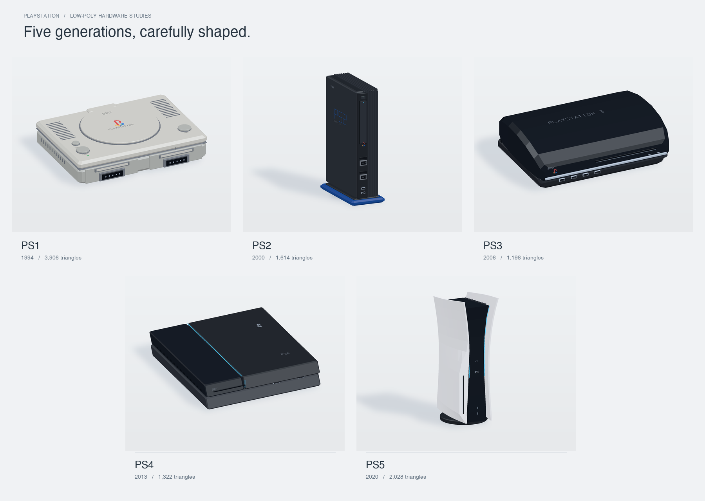

# Low-poly PlayStation collection



Five original-generation console studies with chamfered shells, small geometric markings, detailed ports, and material-specific finishes. The PS3 uses a swept, faceted vault; the PS5 uses curved double-surface panels with an integrated disc-drive swelling. No textures, external assets, runtime packages, or network connection are required.

| Model | Design | Triangles | GLB |
|---|---|---:|---|
| PS1 | Original gray console, circular lid, controller ports | 3,906 | [ps1.glb](models/ps1/ps1.glb) |
| PS2 | Original tower in a blue vertical stand | 1,614 | [ps2.glb](models/ps2/ps2.glb) |
| PS3 | Original curved “fat” console, chrome trim | 1,198 | [ps3.glb](models/ps3/ps3.glb) |
| PS4 | Original slanted, two-tier console | 1,322 | [ps4.glb](models/ps4/ps4.glb) |
| PS5 | Original disc edition, flared white panels | 2,028 | [ps5.glb](models/ps5/ps5.glb) |

## Preview

Open **[preview/index.html](preview/index.html)** in a WebGL-capable browser. It works directly from the filesystem. Select a console, drag to orbit, scroll or pinch to zoom, and toggle auto-rotation. Keyboard orbit/zoom controls are available when the canvas is focused. Each console has GLB, OBJ and MTL download links.

Alternatively, run `python3 -m http.server 8000` from this folder and visit `http://localhost:8000/preview/`.

## Use the assets

Each `models/psN/` folder contains:

- `psN.glb` — self-contained glTF 2.0 binary with PBR materials, explicit flat normals, and named component meshes. Import into Blender, Godot, Unity (with a glTF importer), or another glTF-capable tool.
- `psN.obj` + `psN.mtl` — portable geometry and diffuse materials. Keep these files together.

All models use **Y up**, face **−Z**, and rest at **Y = 0**. Their horizontal origin is at the body center. Dimensions are stylized scene units, not engineering measurements or exact physical scale. The collection board frames each model independently to show its details. The collection intentionally exaggerates ports and shell features for readability. Parts overlap and remain separate; these are visual/game assets, not watertight 3D-printing meshes. Controllers and cables are not included.

The badges and small lettering are simplified geometry, so they remain sharp without texture maps. PlayStation and the console designs belong to their respective owners; this is an unofficial modeling study.

## Rebuild

Requires Python 3.9+ and only its standard library:

```sh
python3 scripts/generate_models.py
python3 scripts/validate_models.py
```

The generator rewrites the GLB/OBJ/MTL assets, `models/manifest.json`, and the preview's embedded geometry in `preview/models.js`. Change dimensions, geometry, or materials in `scripts/generate_models.py`, then regenerate. The preview contains the same source geometry as the exports; it adds simple preview-only contact shadows.

An optional still renderer, `python3 scripts/render_preview.py`, recreates `preview/collection.png` from the mesh geometry. It requires NumPy and Pillow; asset generation and validation need only the Python standard library. Individual 1000 × 800 renders are saved as `preview/ps1.png` through `preview/ps5.png`. The still renderer and WebGL viewer use the actual model geometry and material-aware studio lighting.
